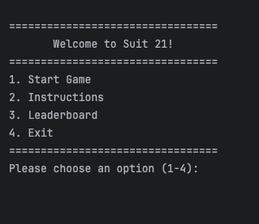
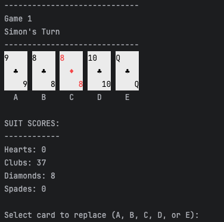
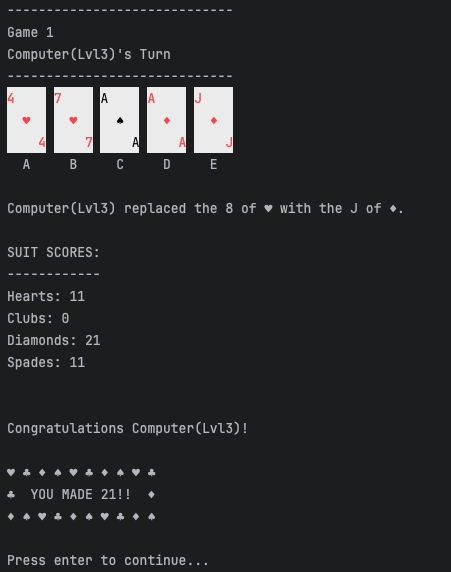

# Suit 21

**Suit 21** is a console-based Java card game for 2 to 6 players where the goal is to score exactly 21 points in a single suit. The game features a main menu, instructions, a leaderboard and gameplay against computer players with three increasing difficulty levels: easy, medium and hard.

**This project was completed as part of the "Programming in Practice" module for university, using Java.**

---

## Features
- Multiplayer support: 2 to 6 players
- Play against computer opponents with **three difficulty levels**
- On each turn, players **swap 1 card** with the deck
- Customizable number of games
- Card values:
  - Number cards: face value
  - Face cards (Jack, Queen, King): 10 points
  - Ace: 1 or 11 points
- Leaderboard to track player scores
- Instructions available in-game

---

## How to Play
1. Start the game from the main menu.
2. Each player receives 5 cards at the beginning.
3. Players take turns **swapping 1 card** from their hand with one from the deck.
4. The goal is to reach **exactly 21 points in a single suit**, using any number of cards.
5. The player(s) who score 21 first win the round. Other players get one last turn if someone reaches 21.
6. Points are tracked on the leaderboard. If multiple players reach 21 in the same round, the point is shared. If no one reaches 21 and the deck runs out, no point is awarded.

## Game Screenshots

